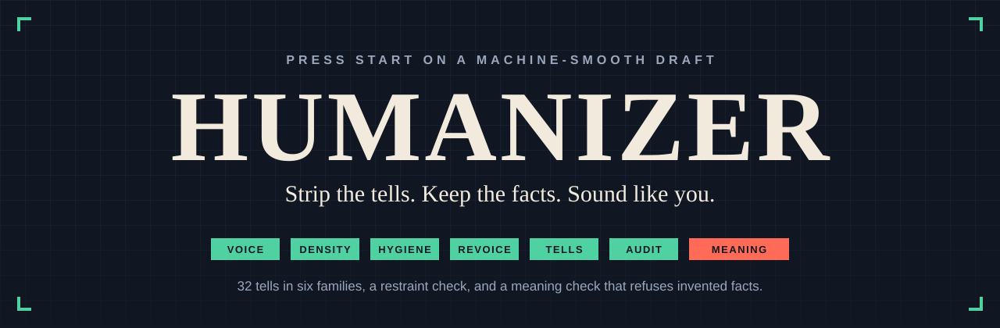
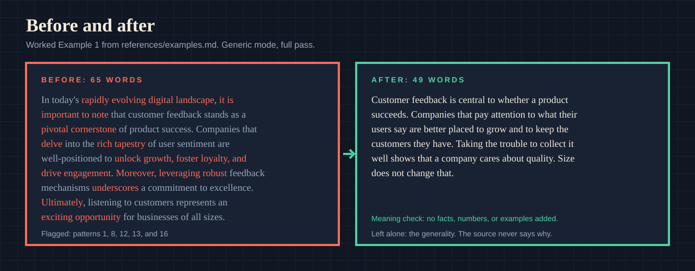
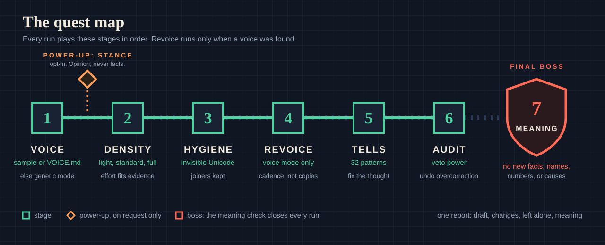
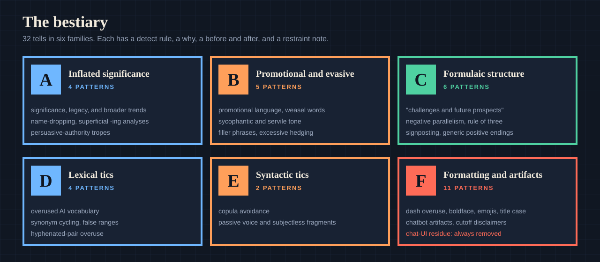

<p align="center">
  
</p>

[](https://www.npmjs.com/package/@hxp-tools/humanizer)
[](https://github.com/hannsxpeter/humanizer/actions/workflows/ci.yml)
[](CHANGELOG.md)
[](LICENSE)


humanizer turns a machine-smooth draft into a quest with one rule: the
rewrite may change how it sounds, never what it says. Your coding agent does
the writing. humanizer gives it a catalog of 32 AI tells to hunt, a voice to
aim at when you have one, a restraint check that protects writing that is
already human, and a meaning check that refuses invented facts.

It is one skill: `SKILL.md` plus five reference files. No scripts, no
dependencies, no network access.

## Press start

```bash
npx @hxp-tools/humanizer
```

That copies the skill into `~/.agents/skills/humanizer`, plus
`~/.claude/skills` and `~/.cline/skills` when those tools are present. Use
`--project` to install into the current project instead, `--tools claude` to
pick targets, and `--uninstall` to remove what it installed. It never touches
a folder that is a git clone or is not humanizer.

Prefer git? Clone it straight into a skills folder; the folder name must stay
`humanizer`:

```bash
git clone https://github.com/hannsxpeter/humanizer ~/.agents/skills/humanizer
```

Then ask in plain words. You do not need to say "humanize":

```text
this reads like ChatGPT, can you fix it
make this sound like me, my style file is in the repo
```

## Before and after

<p align="center">
  
</p>

Every run returns the rewrite plus a short report: what changed, what was
deliberately left alone, a text-hygiene status, a meaning check, and a next
step. The full run is Example 1 in
[references/examples.md](references/examples.md).

## The quest map

<p align="center">
  
</p>

| Stage | What happens |
| --- | --- |
| Voice | Finds the target: a pasted sample, a named author, or a `VOICE.md` / `STYLE-GUIDE.md` in the project. None found means generic mode, never an invented persona. |
| Density | Counts the dead-giveaway tells and picks a light, standard, or full pass, so human-first text is not over-edited. |
| Hygiene | Removes invisible Unicode residue and keeps joiners, direction marks, and spaces that carry meaning. |
| Revoice | Voice mode only. Rewrites toward the writer's cadence and stance, never their sentences. |
| Tells | Walks the catalog and fixes the thought under each tell, not the word on top of it. |
| Audit | Undoes overcorrection: stripped details, flattened quirks, a new uniform rhythm. It can veto the earlier passes. |
| Meaning | The boss. No fact, number, name, quote, or cause the source lacked. Soft inferences get named and hedged or cut. |

## Power-up: stance mode

Off by default. Ask for "more edge," "a take," or "some voice" and the rewrite
may react to your facts with judgment, emphasis, or dry understatement. It
still cannot add a fact, a cause, or an event to react to. The report header
says when stance is on.

## The bestiary

<p align="center">
  
</p>

Each of the 32 patterns has a detect rule, a reason it reads as machine, a
before and after, and a restraint note on when to leave it alone. The full
catalog is [references/tell-patterns.md](references/tell-patterns.md). The
false positives it refuses to flag, such as perfect grammar, a single dash,
or formal vocabulary, are in
[references/do-not-flag.md](references/do-not-flag.md).

## Achievements

Each achievement is a line or section of the report the skill must print.

<p align="center">
  
  
  
  
</p>

| Achievement | Where the report shows it |
| --- | --- |
| In voice | The `Voice:` header line names the sample, author, or file it matched |
| Clean | The `Text hygiene:` header line lists what was removed |
| Restrained | "Deliberately left alone" names what looked like a tell and stayed |
| Faithful | "Meaning check" confirms nothing changed, or names what drifted |

These are the model's own report, not an external test. Read the meaning check
before you ship the rewrite.

## Works with your tools

Tools with Agent Skills support load `SKILL.md` from a skills folder. When
this repository is the workspace, each tool also picks up its rules file, and
every rules file routes to the same `SKILL.md`.

| Tool | Rules file it reads | Agent Skills folders |
| --- | --- | --- |
| Claude Code | `AGENTS.md` when no `CLAUDE.md` exists | `~/.claude/skills/` |
| Codex | `AGENTS.md` | `~/.agents/skills/` |
| Cursor | `AGENTS.md` | `~/.agents/skills/`, `~/.claude/skills/` |
| GitHub Copilot | `AGENTS.md` in VS Code, the CLI, and the cloud agent | `~/.agents/skills/`, `.github/skills/` |
| Gemini CLI | `GEMINI.md`, which imports `AGENTS.md` | `~/.agents/skills/`, `~/.gemini/skills/` |
| Google Antigravity | `AGENTS.md` and `GEMINI.md` | `.agents/skills/` in the project |
| OpenCode | `AGENTS.md` | `~/.agents/skills/`, `~/.claude/skills/` |
| Pi | `AGENTS.md` | `~/.agents/skills/`, `~/.pi/agent/skills/` |
| Devin Desktop | `AGENTS.md` | `~/.agents/skills/` |
| Cline | `AGENTS.md` | `~/.cline/skills/` |
| Zed | `AGENTS.md` (the first rules file it finds) | `~/.agents/skills/` |
| Continue | `.continue/rules/humanizer.md` | not documented |
| Aider | `AGENTS.md`, via `aider --read AGENTS.md` | none |

If your project already has its own `AGENTS.md`, install the skill instead of
overwriting that file.

## Limits

- It improves prose quality and authentic voice. It is not built or tuned to
  defeat plagiarism checkers or AI detectors, and it names none. Requests to
  pass AI work off as a person's own for a graded or contractual assessment
  are reframed toward quality and voice.
- Text hygiene covers characters in the supplied prose only. It does not
  touch C2PA, EXIF, XMP, document metadata, or media. The cleanup ideas are
  adapted from
  [watermarks-remover](https://github.com/guillaumemeyer/watermarks-remover),
  whose file and media tooling is deliberately left out.
- A rewrite may disturb statistical token patterns as a side effect. Nothing
  is tuned for that, and nothing promises it.
- The meaning check is the model checking itself. It catches a lot; it is not
  proof.

## Evals

[evals/evals.json](evals/evals.json) holds eight verification cases: one per
worked example, plus a detector-evasion request, an oblique trigger, stance
mode, and a single chat-UI artifact in human-written text. Run them with an
eval harness such as Anthropic's skill-creator, or paste each prompt into a
fresh session and grade the output against its expectations.

## Contributing

The method lives in `SKILL.md` and `references/`. `AGENTS.md` routes every
tool to it; `GEMINI.md` imports it and the Continue rule carries its body
verbatim. Worked examples obey the hard rule themselves: no fact, number, or
name the source lacks, and each one has a mirror eval.

Run `python3 .github/scripts/check_drift.py` before a pull request. CI runs
it on every push and pull request, along with an installer smoke test. It
checks versions, counts, adapters, file references, this layout, and house
style (no em or en dashes, no emojis, prose wrapped at 80 columns). Whether
the examples stay faithful still needs a human read.

To release, move the `Unreleased` notes in `CHANGELOG.md` under the new
version, bump `metadata.version` in `SKILL.md`, `package.json`, and the
version badge, tag `vX.Y.Z`, publish a GitHub release, then `npm publish`.

## Layout

```
SKILL.md                        the skill: workflow, guardrails, output contract
references/tell-patterns.md     the 32-pattern catalog (read in Pass 2)
references/do-not-flag.md       false positives, human markers, stop conditions
references/voice-matching.md    voice discovery and application
references/text-hygiene.md      conservative invisible-Unicode cleanup
references/examples.md          five worked end-to-end runs
AGENTS.md                       entry point for every tool that reads AGENTS.md
GEMINI.md                       Gemini CLI context; imports AGENTS.md
.continue/rules/humanizer.md    Continue rule
bin/humanizer.js                the npx installer (packaging, not the skill)
package.json                    npm package @hxp-tools/humanizer
docs/assets/                    README graphics
evals/evals.json                eight verification cases (not part of the skill)
evals/files/VOICE.md            voice profile used by eval 2 and Example 2
CHANGELOG.md                    release history
.github/workflows/ci.yml        CI: consistency check and installer smoke test
.github/scripts/check_drift.py  the consistency check (repo tooling)
.github/dependabot.yml          weekly updates for the workflow's actions
```

## The family

humanizer is part of [`@hxp-tools`](https://www.npmjs.com/org/hxp-tools). Its
voice-preservation logic comes from
[Scriveno](https://github.com/hannsxpeter/scriveno), a writing, publishing,
and translation pipeline for AI coding agents
(`npx @hxp-tools/scriveno@latest`). Siblings:
[godplans](https://github.com/hannsxpeter/godplans) plans,
[goddesign](https://github.com/hannsxpeter/goddesigns) designs, and
[godaudits](https://github.com/hannsxpeter/godaudits) audits.

MIT licensed. See [LICENSE](LICENSE).
